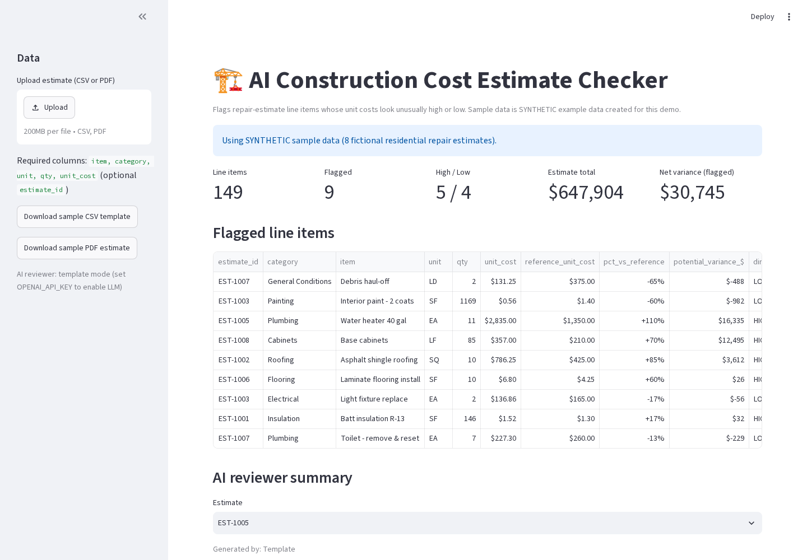
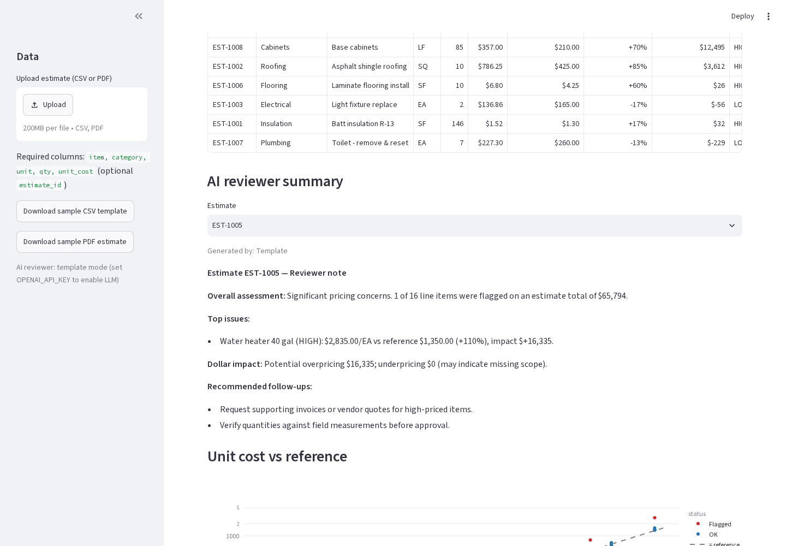
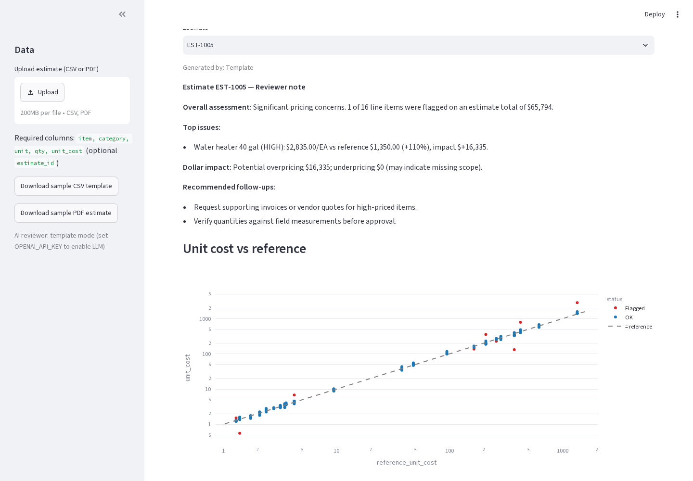
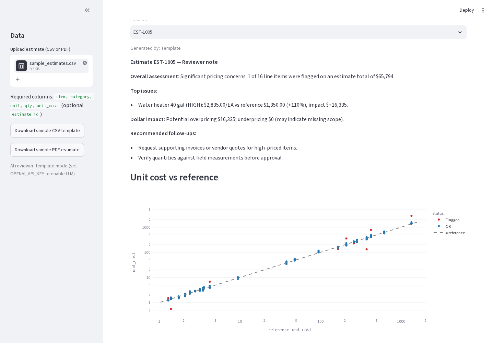
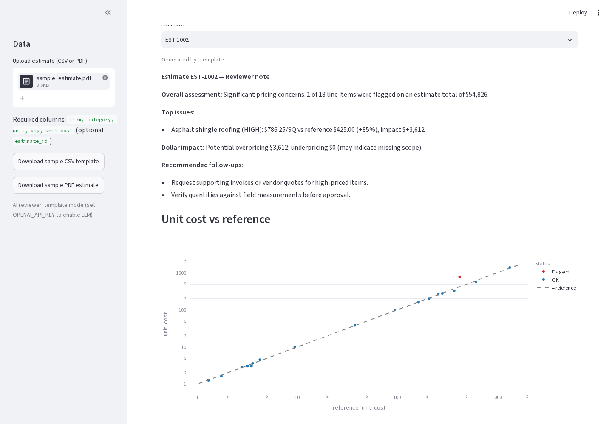

# AI Construction Cost Estimate Checker

A Python tool that reviews residential repair cost estimates (CSV or PDF), flags line items whose **unit costs look unusually high or low** with a plain-English reason for each, and writes an **AI reviewer note** per estimate summarizing the issues, dollar impact, and recommended follow-ups.

> **Data notice:** All data in `data/` is **synthetic example data** generated by `generate_sample_data.py`. It is not from any real company, client, project, or pricing database.

## The problem
In disaster-recovery and insurance repair work, reviewers compare contractor estimates line by line against expected pricing. Doing this by hand across many estimates is slow, and overpriced items (or underpriced items that hint at missing scope) are easy to miss. This tool automates the first pass so a reviewer can focus on the items that need attention.

## How it works
Each line item is checked three ways:

| Check | What it asks | Method |
|---|---|---|
| vs reference | Is this unit cost far from the typical price for this item? | % difference vs a reference unit-cost table (default ±25%) |
| vs peers | Is it out of line with the same item on other estimates? | Z-score (±2) and IQR fences (1.5×) |
| Anomaly model | Does the overall pattern look unusual? | scikit-learn `IsolationForest` on cost ratio, peer z-score and quantity |

PDF estimates are read with `pdfplumber`: the tool finds the line-item table and maps headers like *Description / UOM / Quantity / Unit Price* to the expected columns.

An item is flagged if it misses the reference threshold, or if at least two checks agree. Each flag gets a reason (e.g. *"Unit cost $786.25/SQ is 85% above the reference $425.00; outlier vs 7 peer estimates… Verify scope/quantity or request backup pricing."*) and a dollar variance (`(unit cost − reference) × qty`).

### AI reviewer summary
For each estimate the app writes a reviewer-style note: overall assessment, top issues, dollar impact, and recommended follow-ups. If an `OPENAI_API_KEY` environment variable is set, an LLM writes the note using only the checker's computed facts; with no key (or if the call fails) a deterministic template writes it, so the app always works. Keys are read from the environment only and are never stored in the code.

## Screenshots
*(All data shown is synthetic.)*

**Dashboard: metrics and flagged line items**


**AI reviewer summary**


**Unit cost vs reference chart**


**CSV upload**


**PDF estimate upload**


## How to run
```bash
python -m venv .venv
source .venv/bin/activate        # Windows: .venv\Scripts\activate
pip install -r requirements.txt

python generate_sample_data.py   # (re)create the synthetic sample data
python make_sample_pdf.py        # (re)create the synthetic sample PDF estimate
python checker.py                # command-line report -> flagged_report.csv
streamlit run app.py             # web app at http://localhost:8501
python tests_smoke.py            # smoke tests: sample, CSV and PDF paths

# optional: AI-written reviewer notes
export OPENAI_API_KEY=your_key_here   # Windows: set OPENAI_API_KEY=...
```
In the app you can use the sample data or upload a PDF estimate or your own CSV with columns `item, category, unit, qty, unit_cost` (optional `estimate_id`). Item names must match `data/reference_unit_costs.csv` for the reference check.

## Project structure
```
app.py                     Streamlit web app (upload, metrics, flagged table, chart)
checker.py                 Analysis logic (reference, peer, and ML checks)
reviewer.py                AI reviewer note (LLM if key set, template otherwise)
pdf_parser.py              Reads line-item tables from PDF estimates
make_sample_pdf.py         Builds the synthetic sample PDF estimate
tests_smoke.py             Smoke tests for sample / CSV / PDF paths
capture_screenshots.py     Regenerates the README screenshots
generate_sample_data.py    Builds the synthetic dataset
data/                      Synthetic sample estimates (CSV + PDF) + reference unit costs
docs/screenshots/          App screenshots
WALKTHROUGH.md             Plain-English tour of the code
```

## Tech
Python · pandas · NumPy · scikit-learn · Streamlit · Plotly · pdfplumber · OpenAI API (optional)

## Next steps
- Support regional cost adjustments
- Fuzzy-match item descriptions that don't exactly match the reference table
- Export the reviewer note as a formatted PDF memo
- OCR support for scanned PDF estimates
