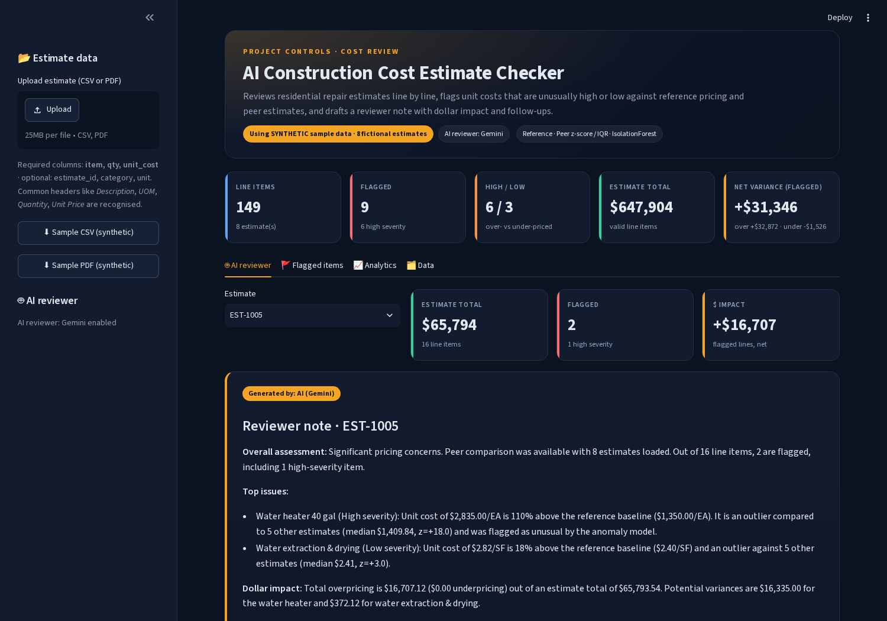
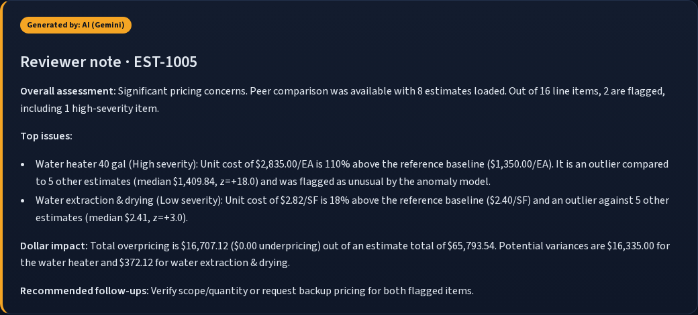
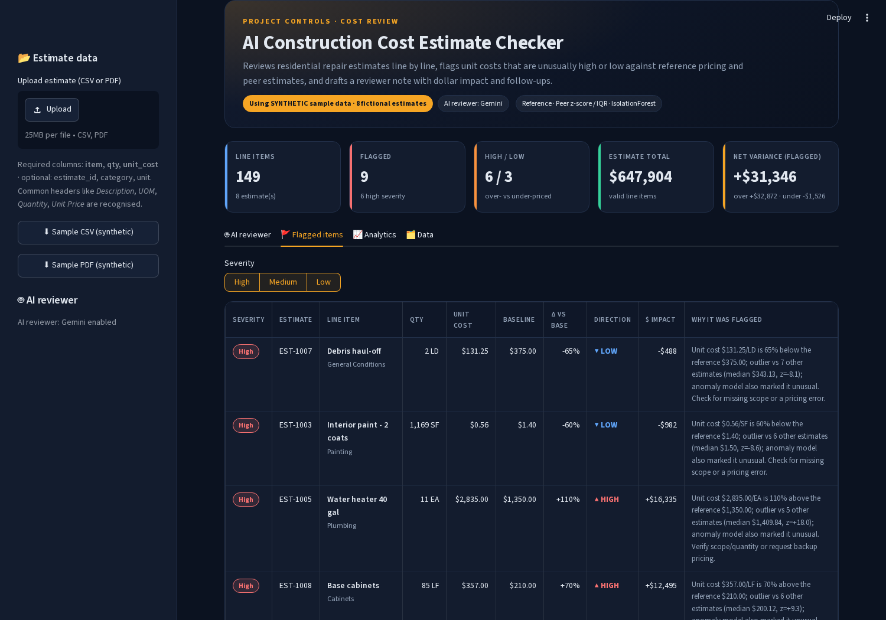
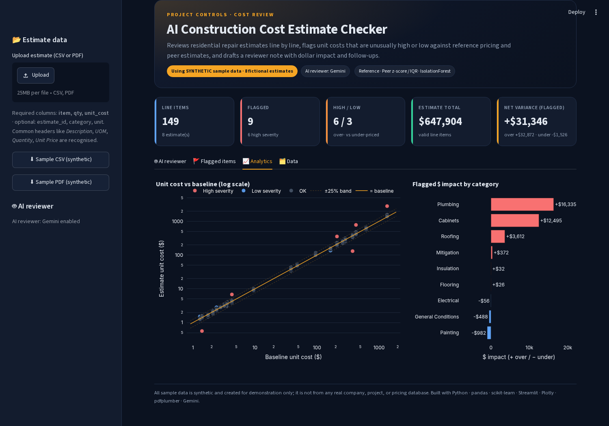
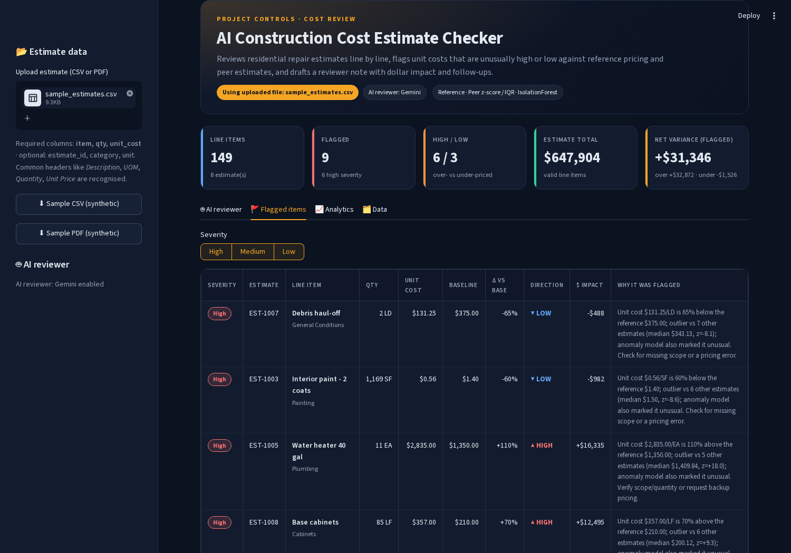
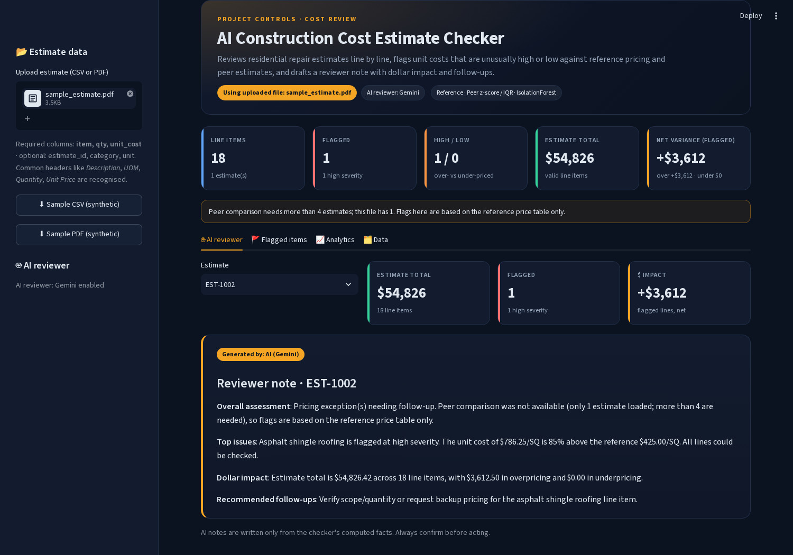

# AI Construction Cost Estimate Checker

A Python tool for **project controls and construction cost review**. It reads residential repair estimates (CSV or PDF), flags line items whose **unit costs look unusually high or low**, rates each flag by severity, explains it in plain English, and writes an **AI reviewer note** per estimate with dollar impact and recommended follow-ups.

> **Data notice:** All data in `data/` is **synthetic example data** generated by `generate_sample_data.py` and `make_sample_pdf.py`. It is not from any real company, client, project, or pricing database.



## The problem
In disaster-recovery and insurance repair work, reviewers compare contractor estimates line by line against expected pricing. Doing this by hand across many estimates is slow, and overpriced items (or underpriced items that hint at missing scope) are easy to miss. This tool automates the first pass so a reviewer can focus on the lines that need attention.

## How it works
Each valid line item is checked three ways:

| Check | What it asks | Method |
|---|---|---|
| vs reference | Is this unit cost far from the typical price for this item **and unit**? | % difference vs a reference unit-cost table (flag beyond ±25%) |
| vs peers | Is it out of line with the same item/unit on **other** estimates? | Leave-one-out z-score (beyond ±3) and IQR fences (1.5×); needs ≥4 other estimates and a ≥15% gap from the peer median |
| Anomaly model | Does the overall pattern look unusual? | scikit-learn `IsolationForest` on cost ratio, peer z-score and quantity (runs when ≥20 lines have a baseline) |

- **Flag rule:** beyond the reference threshold, **or** at least two checks agree.
- **Baseline:** the reference unit cost, or the median of other estimates when the item isn't in the reference table.
- **$ impact:** `(unit cost − baseline) × qty`. Positive means possible overpricing; negative means possible underpricing or missing scope.
- **Severity:** **High** = ≥50% off baseline or ≥$5,000 impact · **Medium** = ≥25% · **Low** = other flagged lines.
- **Data quality:** rows with a missing item, or a missing, non-numeric, zero or negative qty/unit cost are set aside and listed in the Data tab instead of crashing the analysis. Items whose unit differs from the reference table (e.g. SY vs SF) skip the reference check rather than being compared incorrectly.
- **Inputs:** CSV headers are matched flexibly (*Description*, *UOM*, *Quantity*, *Unit Price*…), and currency text like `$1,200.00` is parsed. PDF estimates are read with `pdfplumber`, including tables that continue across pages. Scanned image-only PDFs are not supported.

### AI reviewer note
For each estimate the app writes a reviewer-style note: overall assessment, top issues, dollar impact, and recommended follow-ups. The LLM receives **only the checker's computed facts**, plus a suggested assessment level so the tone stays proportionate. With a single estimate (e.g. one uploaded PDF) peer comparison isn't possible, and the note says so.

Provider order:
1. **Google Gemini** (primary, free tier): `GEMINI_API_KEY` or `GOOGLE_API_KEY`, model via `GEMINI_MODEL` (default `gemini-3.8-flash`). On "model busy" (HTTP 503) it retries, then tries `gemini-3.5-flash-lite`.
2. **OpenAI** (optional): `OPENAI_API_KEY`, model via `OPENAI_MODEL`.
3. **Deterministic template**: no key needed, so the app always works.

Keys are read from environment variables or Streamlit secrets (`.streamlit/secrets.toml`, which is git-ignored, or the Secrets box on Streamlit Community Cloud). They are never stored in the code. AI notes are cached per session; template fallbacks are not, so a busy model is retried on the next interaction.

## Screenshots
*(All data shown is synthetic.)*

| | |
|---|---|
| **AI reviewer note**  | **Flagged items with severity badges**  |
| **Analytics**  | **CSV upload**  |
| **PDF estimate upload (single estimate, caveated)**  | |

## How to run
```bash
python -m venv .venv
source .venv/bin/activate        # Windows: .venv\Scripts\activate
pip install -r requirements.txt

python generate_sample_data.py   # (re)create the synthetic sample CSVs
python make_sample_pdf.py        # (re)create the synthetic sample PDF estimate
python checker.py                # command-line report -> flagged_report.csv
streamlit run app.py             # web app at http://localhost:8501

# tests
python tests_smoke.py            # app + sample / CSV / PDF paths
python tests_edge_cases.py       # bad columns, bad values, unknown items, zero costs, single PDF...
python tests_llm_fallback.py     # reviewer falls back to template with no / invalid key

# optional: AI-written reviewer notes (free key: https://aistudio.google.com/app/apikey)
export GEMINI_API_KEY=your_key_here   # Windows: set GEMINI_API_KEY=...

# optional: regenerate screenshots + browser checks
pip install -r requirements-dev.txt && playwright install chromium
python capture_screenshots.py    # with the app running on port 8599
```
Upload a PDF estimate or a CSV with columns `item, qty, unit_cost` (optional `estimate_id, category, unit`). Item names are matched to `data/reference_unit_costs.csv` ignoring case and extra spaces.

## Project structure
```
app.py                     Streamlit web app (tabs: AI reviewer, Flagged items, Analytics, Data)
ui.py                      Colors, CSS, KPI cards, severity badges, flagged-items table
checker.py                 Analysis logic (reference, peer and ML checks, severity, data cleaning)
reviewer.py                AI reviewer note (Gemini → OpenAI → template)
pdf_parser.py              Reads line-item tables from PDF estimates
generate_sample_data.py    Builds the synthetic CSV dataset
make_sample_pdf.py         Builds the synthetic sample PDF estimate
tests_*.py                 Smoke, edge-case and AI-fallback tests
capture_screenshots.py     Browser checks + README screenshots (Playwright)
.streamlit/config.toml     Dark navy / amber theme
data/                      Synthetic sample estimates (CSV + PDF) + reference unit costs
docs/screenshots/          App screenshots
WALKTHROUGH.md             Plain-English tour of the code
```

## Tech
Python · pandas · NumPy · scikit-learn · Streamlit · Plotly · pdfplumber · Google Gemini API · OpenAI API (optional)

## Limitations and next steps
- The reference table is a small synthetic price book. Real use needs a maintained, regional cost database.
- Fuzzy-match item descriptions that don't exactly match the reference table
- OCR for scanned PDF estimates
- Export the reviewer note as a formatted PDF memo
